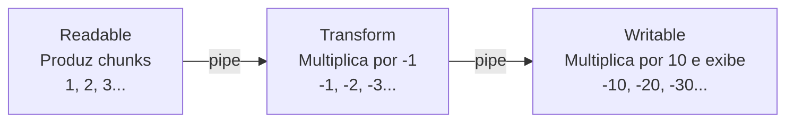
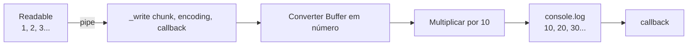
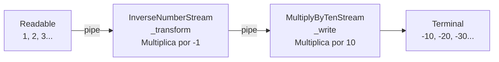

# Fundamentos de Streams no Node.js

Streams permitem **consumir, produzir e transformar dados em partes (_chunks_)**, sem precisar carregar todo o conteúdo na memória antes de iniciar o processamento. São utilizadas, por exemplo, em requisições e respostas HTTP, leitura de arquivos e uploads de CSV.

## Visão geral



Os dados avançam pelo fluxo à medida que ficam disponíveis. O `pipe()` conecta as streams e ajuda a gerenciar o _backpressure_ (quando a etapa consumidora é mais lenta que a produtora).

## 1. Readable — leitura

```mermaid
flowchart LR
    A[_read()] --> B[Gerar próximo número]
    B --> C[Buffer.from String i]
    C --> D[push buffer]
    D --> E[process.stdout]
    B -->|Após 100| F[push null<br/>Fim da stream]
```

A classe `OneToHundredStream` estende `Readable`. O método `_read()` produz números de 1 a 100, com intervalo de um segundo. `push(buffer)` entrega um chunk; `push(null)` indica o fim da leitura.

**Executar a partir da raiz do projeto:**

```bash
node src/streams/readableStream.js
```

**Exemplo de saída:** `1, 2, 3, ... 100` (separados por vírgula na versão estudada).

## 2. Writable — escrita



A classe `MultiplyByTenStream` estende `Writable`. `_write(chunk, encoding, callback)` recebe cada chunk, processa o número e chama `callback()` para sinalizar que terminou de tratar aquele chunk. A Writable **consome** os dados; não emite chunks transformados para outra stream.

```bash
node src/streams/writableStream.js
```

**Exemplo de saída:** `10`, `20`, `30` ... `1000`, um por linha.

## 3. Transform — transformação



A classe `InverseNumberStream` estende `Transform`. O método `_transform(chunk, encoding, callback)` recebe o chunk, converte o número em seu oposto e chama `callback(null, Buffer.from(String(transformed)))`. O primeiro argumento (`null`) indica ausência de erro; o segundo é o novo chunk a ser encaminhado.

```bash
node src/streams/transformStream.js
```

**Exemplo de saída:** `-10`, `-20`, `-30` ... `-1000`, um por linha.

## Comparação

| Tipo        | Método principal       | Responsabilidade                                                     |
| ----------- | ---------------------- | -------------------------------------------------------------------- |
| `Readable`  | `_read()`              | Disponibilizar chunks para leitura                                   |
| `Writable`  | `_write()`             | Receber e consumir chunks                                            |
| `Transform` | `_transform()`         | Receber, transformar e emitir chunks                                 |
| `Duplex`    | `_read()` e `_write()` | Permitir leitura e escrita na mesma stream, sem exigir transformação |

## Conceitos essenciais

- **Chunk:** parte dos dados que percorre a stream.
- **Buffer:** representação de bytes em memória, usada nos exemplos para transportar números convertidos em texto.
- **`pipe()`:** conecta uma stream legível a uma gravável, incluindo Transform.
- **`process.stdin`:** entrada padrão do processo, normalmente o terminal.
- **`process.stdout`:** saída padrão do processo, normalmente o terminal.
- **Backpressure:** mecanismo que evita que o produtor avance indefinidamente quando o consumidor não acompanha.

> **Atenção:** nos exemplos de Writable e Transform, cada chunk contém somente um número, sem vírgula. Se a Readable enviar `"1, "`, a conversão com `Number(chunk.toString())` resultará em `NaN`. Por isso, cada arquivo demonstra sua própria formatação de dados.

Para interromper qualquer exemplo antes do término, use **Ctrl+C**. Os comandos pressupõem que o projeto esteja configurado para módulos ES (`"type": "module"` no `package.json`, ou configuração equivalente).
