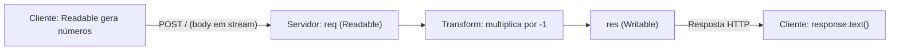
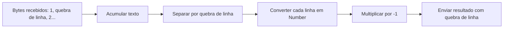

# Streams em HTTP com Node.js

Nesta aula, conectamos os conceitos de **Readable**, **Transform** e **Writable** a um servidor HTTP. O cliente envia números aos poucos, o servidor os transforma em negativos e escreve a resposta sem esperar todos os números chegarem.

## Fluxo da aplicação



## Arquivos

- `fakeUploadHttpStream.js`: simula um upload HTTP, enviando um número a cada segundo usando `fetch()`.
- `httpStreamServer.js`: recebe a requisição, transforma cada número e envia o resultado na resposta.

## Executar

Na raiz do projeto, abra **dois terminais**:

**Terminal 1 — servidor:**

```bash
node src/streams/http/httpStreamServer.js
```

**Terminal 2 — cliente:**

```bash
node src/streams/http/fakeUploadHttpStream.js
```

O servidor exibe `-1`, `-2`, ..., `-100` progressivamente. O cliente imprime a resposta completa quando o envio e a leitura terminam, cerca de 101 segundos depois. Use `Ctrl+C` para parar o servidor.

## Fundamentos

| Conceito                | No exemplo                   | Responsabilidade                              |
| ----------------------- | ---------------------------- | --------------------------------------------- |
| `Readable`              | `OneToHundredStream` e `req` | Produzir ou receber dados progressivamente    |
| `Transform`             | `InverseNumberStream`        | Ler números e produzir seus negativos         |
| `Writable`              | `res`                        | Enviar a resposta HTTP progressivamente       |
| `pipe()` / `pipeline()` | Encadeamento no servidor     | Conectar as etapas e gerenciar _backpressure_ |
| `Buffer`                | Dados enviados pelas streams | Representar bytes em memória                  |
| `push(null)`            | Cliente                      | Indicar o fim da produção de dados            |
| `duplex: 'half'`        | `fetch()` do Node            | Permitir corpo de requisição em stream        |

## Por que usar `\n` entre os números?

**Chunks não são mensagens.** Um `push()` de `12` pode chegar ao servidor dividido em partes, ou junto de outros valores. Se enviarmos `1`, `2`, `3` sem separadores, o servidor poderá interpretar `123` como um único número. Neste exemplo, cada número termina com uma quebra de linha (`\n`), e o servidor acumula os bytes até encontrar esse delimitador.



## Diferença em relação ao exemplo da aula

O exemplo original usa `req.pipe(new InverseNumberStream()).pipe(res)`. Isso ilustra corretamente o encadeamento, mas pressupõe que cada chunk contenha um número completo. Aqui usamos `pipeline()` para tratar erros e encerramento do fluxo, além de separar números por linhas para não depender dos limites dos chunks. O objetivo didático permanece o mesmo.

**Importante:** a conexão HTTP pode permanecer aberta enquanto os dados chegam; isso não significa que toda aplicação HTTP seja bidirecional. Neste exemplo, o `fetch()` do Node usa `duplex: 'half'` e o cliente lê a resposta ao final do envio. O servidor, entretanto, já transforma os dados progressivamente.
